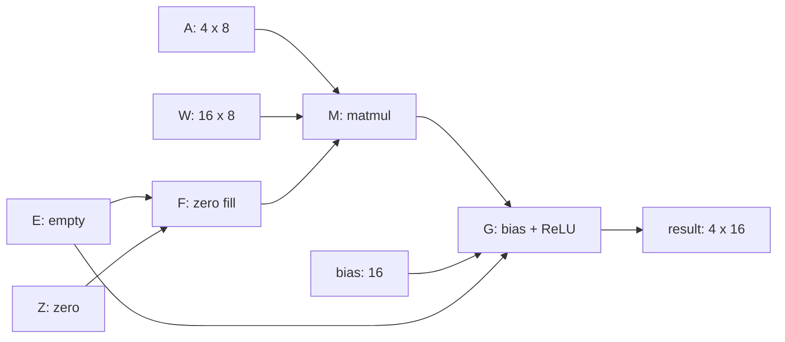
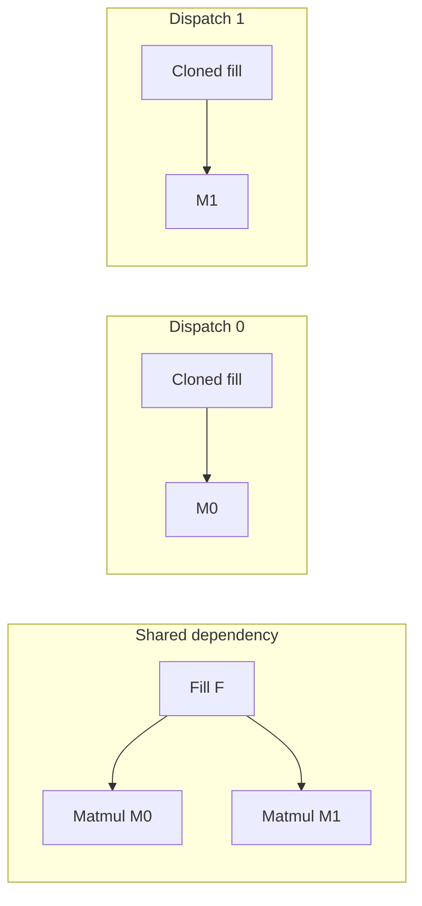

IREE's dispatch-creation stage partitions tensor computations into units that
later stages can compile and schedule independently. The interesting part is deciding where its boundary should go: which computations belong together, which values should cross that boundary, and which producers should be copied into more than one dispatch.


## 1. The problem: where should a tensor graph be cut?

A **dispatch** is a unit of computation that later compiler stages can extract,
compile for a backend, and schedule.

To build dispatches, IREE partitions a graph. Operations are nodes; tensor
dependencies are edges. Putting two operations into the same dispatch gives
later lowering an opportunity to keep their intermediate computation local.
Separating them creates an interface through which a result must be passed.

There are competing goals. Larger groups may avoid intermediate materialization
and dispatch overhead. But their operations must admit compatible tiling and
legal scheduling, and a backend must be able to lower them without excessive
temporary storage.


Our running computation is:

```text
A:    tensor<4x8xf32>
W:    tensor<16x8xf32>
bias: tensor<16xf32>

Y[m,n] = maximum(sum_k A[m,k] * W[n,k] + bias[n], 0)
```

After a preliminary elementwise-fusion pass, the relevant graph is:



There are two different transformations to keep separate:

| Transformation | Effect in this example |
| --- | --- |
| Elementwise fusion | Broadcast, add, and ReLU become one `linalg.generic` body, called `G`. |
| Dispatch grouping | Matmul `M` and generic `G` are assigned to one dispatch but remain separate Linalg operations. |

The second transformation is the focus here. Its implementation separates
**planning** from **rewriting**: first record groups, then create regions and
move operations. The beginning of `createFusionGroups` makes that order explicit:

```cpp
  // Step 1: Decide fusion groups (heuristic).
  FusionTracker tracker;
  decideFusableLinalgOps(funcOp.getFunctionBody(), dominanceInfo, options,
                         tracker);
```

## 2. Example

We want an example where the two fusion steps are visible independently. The
input therefore contains separate broadcast, add, and ReLU generics. Matmul
already expresses the transposed weight access in its indexing maps since it reads
`W[n,k]` directly, without a separate transpose operation.


```mlir
// Y[m, n] = max(sum_k A[m, k] * W[n, k] + bias[n], 0).
// Start directly in IREE's tensor-level input IR to isolate dispatch creation.
module {
  util.func public @matmul_bias_relu(
      %a: tensor<4x8xf32>, %w: tensor<16x8xf32>,
      %bias: tensor<16xf32>) -> tensor<4x16xf32> {
    %zero = arith.constant 0.0 : f32
    %empty = tensor.empty() : tensor<4x16xf32>
    %init = linalg.fill ins(%zero : f32)
      outs(%empty : tensor<4x16xf32>) -> tensor<4x16xf32>
    %mm = linalg.matmul indexing_maps = [
      affine_map<(m, n, k) -> (m, k)>,
      affine_map<(m, n, k) -> (n, k)>,
      affine_map<(m, n, k) -> (m, n)>
    ] ins(%a, %w : tensor<4x8xf32>, tensor<16x8xf32>)
      outs(%init : tensor<4x16xf32>) -> tensor<4x16xf32>
    %broadcast = linalg.generic {
      indexing_maps = [affine_map<(m, n) -> (n)>,
                       affine_map<(m, n) -> (m, n)>],
      iterator_types = ["parallel", "parallel"]
    } ins(%bias : tensor<16xf32>) outs(%empty : tensor<4x16xf32>) {
    ^bb0(%b: f32, %unused: f32):
      linalg.yield %b : f32
    } -> tensor<4x16xf32>
    %sum = linalg.generic {
      indexing_maps = [affine_map<(m, n) -> (m, n)>,
                       affine_map<(m, n) -> (m, n)>,
                       affine_map<(m, n) -> (m, n)>],
      iterator_types = ["parallel", "parallel"]
    } ins(%mm, %broadcast : tensor<4x16xf32>, tensor<4x16xf32>)
      outs(%empty : tensor<4x16xf32>) {
    ^bb0(%x: f32, %b: f32, %unused: f32):
      %s = arith.addf %x, %b : f32
      linalg.yield %s : f32
    } -> tensor<4x16xf32>
    %result = linalg.generic {
      indexing_maps = [affine_map<(m, n) -> (m, n)>,
                       affine_map<(m, n) -> (m, n)>],
      iterator_types = ["parallel", "parallel"]
    } ins(%sum : tensor<4x16xf32>) outs(%empty : tensor<4x16xf32>) {
    ^bb0(%x: f32, %unused: f32):
      %r = arith.maximumf %x, %zero : f32
      linalg.yield %r : f32
    } -> tensor<4x16xf32>
    util.return %result : tensor<4x16xf32>
  }
}
```

The first preparation step combines the three elementwise operations. Its
resulting generic uses `(m,n) -> (n)` to read the bias and contains both scalar
operations in one region:

```mlir
%result = linalg.generic {
  indexing_maps = [
    affine_map<(m, n) -> (m, n)>,
    affine_map<(m, n) -> (n)>,
    affine_map<(m, n) -> (m, n)>
  ],
  iterator_types = ["parallel", "parallel"]
} ins(%mm, %bias : tensor<4x16xf32>, tensor<16xf32>)
  outs(%empty : tensor<4x16xf32>) {
^bb0(%x: f32, %b: f32, %unused: f32):
  %sum = arith.addf %x, %b : f32
  %relu = arith.maximumf %sum, %zero : f32
  linalg.yield %relu : f32
} -> tensor<4x16xf32>
```


We will use `E`, `Z`, `F`, `M`, and `G` from the dependency diagram throughout.
Only `M` and `G` perform the main tensor computation; `E`, `Z`, and `F` prepare
its destinations and initial accumulator.

## 3. Root

Before asking which neighboring operations should join a dispatch, the compiler
needs a starting point. A **root** is the operation chosen to anchor a fusion
group. It supplies a reference computation and an outer parallel iteration
space against which potential group members can be compared.

> The member list of a dispatch group is decided by the "most restrictive" member.

For matmul, the computation has loops `(m,n,k)`. The output dimensions `m,n`
are parallel, while `k` is a reduction. If later lowering assigns an output tile
to a workgroup, matmul determines the reduction work needed to produce that
tile. Bias addition and ReLU can naturally accompany the same output tile.

Once a root is identified, a dispatch group is created from it:

```cpp
  /// Create a new fusion group with `op` as the root.
  FusionGroup &createFusionGroup(MLIRContext *ctx, Operation *op) {
    fusionGroups.push_back(std::make_unique<FusionGroup>(op));
    opToGroup[op] = fusionGroups.back().get();
    return *fusionGroups.back();
  }
```

For our example, this produces:

```text
Group 0
  root: M
  members: {M}
```

This group's stored root stays `M` when consumers are appended. A consumer can
become the next node explored by the search without replacing the group's
root.


### How to find a root


| Candidate | First-sweep policy | Why |
| --- | --- | --- |
| Named Linalg operation such as matmul | Eligible, subject to earlier exclusions | Provides a recognized computation around which to form a group. |
| Generic with reduction loops | Eligible unless the unpack-producer exclusion applies | Provides reduction structure rather than only an elementwise traversal. |
| All-parallel generic `G` | Deferred | May become a neighbor's epilogue; can anchor a fallback group later. |
| Fill `F` | Excluded | Initialization is handled through cloning rather than a dedicated preferred group. |
| Bit-extension-like generic | Excluded | Eligible instances are handled as cloneable producers later. |
| Computation already inside `dispatch.workgroups` | Excluded | Avoids forming nested dispatches there. |


```cpp
static bool isRootLikeOp(Operation *op) {
  if (op->getParentOfType<IREE::Flow::DispatchWorkgroupsOp>()) {
    return false;
  }
  // Dequantization-like ops get cloned into dispatches later.
  if (IREE::LinalgExt::isBitExtendOp(op)) {
    return false;
  }
  // Any Linalg named op or generic op with reduction iterator types is a root
  // op.
  if (auto linalgOp = dyn_cast<linalg::LinalgOp>(op)) {
    if (isa<linalg::GenericOp>(op)) {
      return linalgOp.getNumReductionLoops() != 0 &&
             !hasFusableUnpackProducer(linalgOp);
    }
    return !isa<linalg::FillOp>(op);
  }
  if (isa<TilingInterface>(op)) {
    return !isa<IREE::LinalgExt::GatherOp, tensor::PadOp, tensor::ConcatOp,
                linalg::PackOp>(op);
  }
  return isa<linalg::UnPackOp>(op);
}
```

## 4. Upstream search

Once a root exists, the next question is which surrounding computations can
share its dispatch. There are two complementary searches:

* **Upstream:** follow operands to the operations that produce them.
* **Downstream:** follow result uses to operations that consume them.

Both searches grow the same group. They are asymmetric because producing an
input to a matmul can have very different scheduling and storage requirements
from applying an elementwise epilogue to its output.

The algorithm also needs a single-ownership rule while planning, in other words, an original
operation can belong to only one tracked group. Adding it to a second group
would require an explicit decision to merge groups or duplicate computation.

The tracker enforces that distinction through a map from operations to groups:

```cpp
// Membership storage in FusionTracker:
DenseMap<Operation *, FusionGroup *> opToGroup;

  void appendToFusionGroup(Operation *op, FusionGroup &fusionGroup) {
    assert(!isFusedOp(op) && "op already in a group");
    fusionGroup.insert(op);
    opToGroup[op] = &fusionGroup;
  }

  // Returns if `op` has been added to a FusionGroup in the tracker.
  bool isFusedOp(Operation *op) const { return opToGroup.contains(op); }

  // Returns if `op` is the root of a FusionGroup.
  bool isRootOp(Operation *op) const {
    return isFusedOp(op) && op == getFusionGroup(op).getRoot();
  }
```


For upstream search, we start with `M`, inspect the operations defining its operands,
accept eligible ones, and repeat from each accepted producer (BFS). This is a backward
worklist traversal since we are looking for producers.

```cpp
// Abbreviated traversal
SmallVector<Operation *> worklist;
worklist.push_back(root);
while (!worklist.empty()) {
  Operation *candidate = worklist.pop_back_val();
  for (OpOperand &operand : candidate->getOpOperands()) {
    Operation *producer = operand.get().getDefiningOp();
    if (!producer) continue;
    if (producer->getBlock() != root->getBlock()) continue;
    // ... ownership, edge-compatibility, and outside-user checks ...
    tracker.appendToFusionGroup(producer, fusionGroup);
    worklist.push_back(producer);
  }
}
```


The checks fall into three groups:

| Check | Purpose |
| --- | --- |
| Defining operation and same block | Establishes that there is a movable producer in the supported scope. |
| Cloneable or already assigned | Routes the operation to the correct ownership strategy. |
| Use compatibility, multi-use policy, external users | Ensures that adding this operation is supported and preserves a legal graph boundary. |

For `M`, the direct inputs `%a` and `%w` are function arguments. Its accumulator
comes from `F`, which is cloneable. Therefore this first walk leaves the group
as `{M}`.

## 5. Destination-passing style (DPS)

An operation can consume a value as ordinary input data or as the initial
destination for its result. Those roles matter when deciding how to combine
computations around the root's iteration space.

**Destination-passing style**, or DPS, makes the second role explicit. An
operation receives designated **init operands** that are tied to its results.
For tensor semantics, each tensor init is paired with one result of the same
type and matching dynamic dimensions. Later bufferization can sometimes reuse
the init's storage for that result.

In our matmul, the distinction is visible in the syntax:

```mlir
%mm = linalg.matmul
  ins(%a, %b : tensor<4x8xf32>, tensor<8x16xf32>)
  outs(%init : tensor<4x16xf32>) -> tensor<4x16xf32>
```

`%a` and `%b` are DPS inputs. `%init` is the DPS init, and the mathematical
meaning includes its initial accumulator value:

```text
mm[m,n] = init[m,n] + sum_k A[m,k] * B[k,n]
```

### Init-side producer

An init-side producer prepares the destination on which the next computation
operates, so it is more favored during fusion. An ordinary input producer may need a different tile domain or may
introduce temporary storage before the main computation can run. The default
producer-fusion path is conservative about that difference.

After operation-specific cases, it enforces:

```cpp
  if (!isa<IREE::LinalgExt::LinalgFusionOpInterface>(consumer) ||
      !isa<IREE::LinalgExt::LinalgFusionOpInterface>(producer)) {
    return false;
  }

  if (!options.aggressiveFusion) {
    auto consumerFusionOp = dyn_cast<DestinationStyleOpInterface>(consumer);
    if (consumerFusionOp && !consumerFusionOp.isDpsInit(&operand)) {
      return false;
    }
  }

  if (!tracker.getFusionGroup(consumer).isFusable(producer)) {
    return false;
  }

  // Check operand limit before allowing fusion
  if (tracker.getFusionGroup(consumer).wouldExceedOperandLimit(producer)) {
    return false;
  }

  return true;
}
```

The `isDpsInit(&operand)` test applies to the particular operand edge being
considered. In non-aggressive mode, this ordinary path rejects an input-side
producer of a DPS consumer. 

## 6. Cloning
Some producers should be cloned rather than owned by one group. Group ownership is useful for substantial computations that should execute as part of one selected dispatch. But initialization, small constants, and some conversion computations may be better recreated inside each dispatch that needs
them.

For example, if two matmuls share a fill, forcing the fill into one group's
ownership can create an unnecessary interface for the other matmul. Cloning
lets each dispatch perform its own initialization. The original operation can
remain available to other users until cleanup removes it if unused.



This is why the upstream walk deliberately skips cloneable producers:

```cpp
if (IREE::Flow::isCloneableIntoDispatchOp(producer, cloneableOptions) ||
    tracker.isFusedOp(producer) || tracker.isRootOp(producer)) {
  continue;
}
```

Each condition has a specific meaning:

| Condition | Why the current walk stops |
| --- | --- |
| Cloneable | Leave it to the later cloning strategy rather than assigning its original operation now. |
| Already fused | It already belongs to this or another group; do not assign it again. |
| Already a root | Already covered by `isFusedOp` in this implementation; it adds no extra exclusion. |

The last condition is genuinely redundant under the membership definitions
shown earlier. It does not mean "this operation might make a good root";
that is the separate `isRootLikeOp` query.

The cloning policy explicitly recognizes fill and empty operations:

```cpp
bool isCloneableIntoDispatchOp(Operation *op,
                               CloneableIntoDispatchOptions options) {
  if (isUncloneableOp(op)) {
    return false;
  }

  // TODO(#8637): `tensor.collapse_shape` and `tensor.expand_shape` are
  // trivially cloneable too, but they cause problems
  // with bufferization. Make them cloneable when fixed.
  if (isa<affine::AffineApplyOp, arith::IndexCastOp, linalg::FillOp,
          tensor::EmptyOp, tensor::ExtractOp, tensor::ExtractSliceOp,
          complex::CreateOp, IREE::Encoding::UnsetEncodingOp>(op)) {
    return true;
  }
  // ... other policy checks ...
  if (LinalgExt::isBitExtendOp(op)) {
    return true;
  }
  // ... remaining cases ...
}
```

Later, after dispatch regions exist, the cloning helper repeatedly discovers
eligible producers and copies them into the region:

```cpp
LogicalResult cloneProducersToRegion(RewriterBase &rewriter,
                                     IREE::Flow::DispatchRegionOp regionOp,
                                     CloneableIntoDispatchOptions options) {
  SmallVector<Operation *> cloneableOps;
  do {
    cloneableOps = getCloneableOps(regionOp, options);
    bool sortResult = mlir::computeTopologicalSorting(cloneableOps);
    (void)sortResult;
    assert(sortResult && "could not compute topological sorting");

    for (Operation *producer : llvm::reverse(cloneableOps)) {
      if (failed(clonePrecedingOpIntoDispatchRegion(rewriter, producer,
                                                    regionOp))) {
        return failure();
      }
    }
  } while (!cloneableOps.empty());

  return success();
}
```

For our example, `F` is skipped during group planning, then copied into the
region later. Its dependencies `E` and `Z` are brought in as well. A producer
skipped by the planning walk can therefore appear in the final dispatch body.

## 7. Downstream search

After inspecting upstream dependencies, the algorithm looks for computations
that consume the group's results. For matmul, a natural opportunity is an
epilogue operating independently on each output element, such as bias addition
and ReLU.

Our `G` has two parallel dimensions `(m,n)`. It reads one matmul result element,
adds `bias[n]`, and writes the corresponding output element. It can follow the
matmul's output domain without introducing another reduction domain.

The ordinary consumer-compatibility path checks for all-parallel loops and a
compatible mapping, along with interface and operand-count requirements:

```cpp
  auto producerFusionOp =
      dyn_cast<IREE::LinalgExt::LinalgFusionOpInterface>(producer);
  auto consumerFusionOp =
      dyn_cast<IREE::LinalgExt::LinalgFusionOpInterface>(consumer);
  if (!producerFusionOp || !consumerFusionOp) {
    return false;
  }

  // Check that the consumer is all parallel.
  if (consumerFusionOp.getNumLoops() !=
      consumerFusionOp.getNumParallelLoops()) {
    return false;
  }

  if (!tracker.getFusionGroup(producer).isFusable(consumer)) {
    return false;
  }

  // Check operand limit before allowing fusion
  if (tracker.getFusionGroup(producer).wouldExceedOperandLimit(consumer)) {
    return false;
  }
```

The search starts at each root, collects candidate uses, and groups them by
consumer. If one consumer reads the producer through several operand edges,
every relevant edge must pass the compatibility check. An accepted consumer
joins the group and becomes another downstream search node.

The core loop implements that process directly:

```cpp
  for (Operation *root : roots) {
    SmallVector<Operation *> workList;
    FusionGroup &fusionGroup = tracker.getFusionGroup(root);
    workList.push_back(root);
    while (!workList.empty()) {
      Operation *currRoot = workList.pop_back_val();

      SmallVector<OpOperand *> fusableUses =
          getFusableUses(context, currRoot, dominanceInfo,
                         /*aggressiveFusion=*/options.aggressiveFusion);
      if (fusableUses.empty()) {
        continue;
      }

      // Group operands by owning consumer so the per-operand checks inside
      // `isFusableWithConsumer` are evaluated for every operand of a consumer.
      llvm::MapVector<Operation *, SmallVector<OpOperand *>> usesByConsumer;
      for (OpOperand *use : fusableUses) {
        usesByConsumer[use->getOwner()].push_back(use);
      }

      for (auto &[consumerOp, operands] : usesByConsumer) {
        if (tracker.isRootOp(consumerOp) || tracker.isFusedOp(consumerOp)) {
          continue;
        }

        // Ensure that fusing the consumer would not cause use-def violations.
        if (tracker.getFusionGroup(currRoot)
                .hasTransitiveDependencyOnFusionGroup(consumerOp,
                                                      dominanceInfo)) {
          continue;
        }

        if (!llvm::all_of(operands, [&](OpOperand *use) {
              return isFusableWithConsumer(*use, tracker, options);
            })) {
          continue;
        }
        tracker.appendToFusionGroup(consumerOp, fusionGroup);
        workList.push_back(consumerOp);
      }
    }
  }
```

Here `currRoot` is the current search node, despite its name. Adding `G` to the
worklist does not change `FusionGroup::rootOp` from `M` to `G`.

In non-aggressive mode, the candidate-use collection also requires one distinct
non-`tensor.dim` consumer. This limits how aggressively a group grows into a
branched graph:

```cpp
  // In non-aggressive mode, restrict fusion to producers whose results flow
  // to a single consumer. Count distinct consumers rather than operand uses
  // so that a single consumer reading multiple results from a multi-result
  // producer (e.g. OnlineAttentionOp) still qualifies.
  if (!aggressiveFusion) {
    llvm::SetVector<Operation *> consumers;
    for (Operation *user : op->getUsers()) {
      if (!isa<tensor::DimOp>(user)) {
        consumers.insert(user);
      }
    }
    if (consumers.size() != 1) {
      return {};
    }
  }
```

Our matmul has one such consumer, `G`. The resulting plan is now:

```text
Group 0
  root: M
  members: {M, G}
```

Notice the asymmetry with upstream fusion: `G` uses the matmul result as an
ordinary input, yet can join as an epilogue. The DPS-init restriction is not reapplied to consumer fusion.

## 8. Membership must preserve a legal graph cut

Local compatibility is only part of the problem. A dispatch will eventually
behave as one scheduled unit with an input/output interface. A proposed group
must therefore preserve the dependency order of the surrounding graph.

Consider adding `G` to a group that already contains `M`:


The direct `M -> G` edge is expected. The indirect `M -> X -> G` path is a
problem if `X` stays outside. The dispatch would need `X` as an input, while
`X` needs a result computed inside that same dispatch. Grouping only `{M,G}`
would introduce a cycle between the dispatch and `X`.

The consumer walk rejects this situation before appending the consumer:

```cpp
if (tracker.getFusionGroup(currRoot)
        .hasTransitiveDependencyOnFusionGroup(consumerOp, dominanceInfo)) {
  continue;
}
```

The helper examines backward slices of the candidate's other dependencies.
Direct operands from the group are allowed; an indirect path back into the
group through an outside computation is what it detects. This fragment shows
the distinction; slice configuration and iteration over all operands are omitted:

```cpp
    llvm::SetVector<Operation *> slice;
    auto populateSlice = [&](OpOperand *operand) {
      // It's okay if the consumer directly uses an operation in the fusion
      // group.
      if (loopMaps.contains(operand->get().getDefiningOp())) {
        return;
      }
      LogicalResult result = getBackwardSlice(operand->get(), &slice, options);
      assert(result.succeeded() && "expected a backward slice");
      (void)result;
    };

// ... visit all candidate operands and region captures ...
    return llvm::any_of(loopMaps.getArrayRef(),
                        [&](std::pair<Operation *, AffineMap> pair) {
                          return slice.contains(pair.first);
                        });
```

### Multiple users

A shared producer is not automatically illegal to fuse. Its result might be
returned from the dispatch to satisfy outside users. But allowing multiple
uses does not make every placement valid.

The producer walk separately checks three things:

1. Uses into the current group must all be compatible.
2. The configured multi-use policy must permit the producer.
3. Outside users must not block moving the computation to the dispatch.

The first helper deliberately ignores uses outside the current group:

```cpp
static bool areAllFusionGroupUsesFusableWithProducer(
    Operation *producer, const FusionGroup &fusionGroup,
    const FusionTracker &tracker, FormDispatchRegionsPassOptions const &options,
    bool fuseWithTruncate) {
  return llvm::all_of(producer->getUses(), [&](OpOperand &use) {
    Operation *useOwner = use.getOwner();
    Operation *useOwnerAtProducerLevel =
        producer->getBlock()->findAncestorOpInBlock(*useOwner);
    if (!useOwnerAtProducerLevel ||
        !fusionGroup.contains(useOwnerAtProducerLevel)) {
      return true;
    }
    return useOwnerAtProducerLevel == useOwner &&
           isFusableWithProducer(use, tracker, options, fuseWithTruncate);
  });
```

Outside uses are handled by the later
`hasExternalUserBlockingProducerFusion` call. That helper considers outside
users before the root, existing dispatch regions, and dependencies of the
proposed group.

There is also an important counting detail. When multi-use producer fusion is
disabled, the producer path counts non-`tensor.dim` **operand uses**. The
non-aggressive consumer path shown earlier counts distinct **consumer operations**. One consumer reading the same value twice can pass the latter
restriction and fail the former.

### Compatible iteration geometry

A group must also relate its members' iteration spaces to the root's outer
parallel dimensions. For matmul, an initial mapping can be written:

```text
root parallel coordinates: (m,n)
matmul iteration space:    (m,n,k)
mapping:                  (m,n) -> (m,n,0)
```

The `0` marks a dimension with no corresponding root-parallel coordinate.
It does not fix the reduction index to zero. For the all-parallel epilogue,
the corresponding mapping is simply `(m,n) -> (m,n)`.

The group's compatibility method requires an unambiguous mapping. For a
candidate that is not entirely outer-parallel, it additionally compares that
mapping with the root's. It also rejects certain nested-region implicit uses
of group values, because this algorithm supports fusion through operand edges.
The mapping portion is:

```cpp
    FailureOr<AffineMap> maybeMap = getRootParallelLoopToOpMap(op);
    if (failed(maybeMap)) {
      return false;
    }

    // If the candidate is not all parallel, then its loop configuration should
    // be the same as the root.
    auto candidateOuterParallelLoop = getOuterParallelLoops(op);
    if (candidateOuterParallelLoop.size() !=
        candidateOuterParallelLoop.count()) {
      return loopMaps.lookup(rootOp) == maybeMap.value();
    }
    return true;
```

### Put the upstream policies together

The upstream walk can now be read as a sequence of decisions with distinct
purposes: find a supported dependency edge, respect ownership and cloning
policy, check every use into the group, and reject outside users that block
fusion. Only then assign the producer and continue upstream. Here is the full
helper, using the concepts developed above:

```cpp
/// Starting from the `root` op, traverse the operand use-def chain
/// in reverse to fuse with producers.
static void
fuseRootsWithProducers(MLIRContext *context, Operation *root,
                       FusionGroup &fusionGroup,
                       FormDispatchRegionsPassOptions const &options,
                       FusionTracker &tracker, bool fuseWithTruncate) {
  SmallVector<Operation *> worklist;
  worklist.push_back(root);
  IREE::Flow::CloneableIntoDispatchOptions cloneableOptions;
  cloneableOptions.aggressive = options.aggressiveFusion;
  while (!worklist.empty()) {
    Operation *candidate = worklist.pop_back_val();
    for (OpOperand &operand : candidate->getOpOperands()) {
      Operation *producer = operand.get().getDefiningOp();
      if (!producer) {
        continue;
      }
      // Only fuse producers in the same block as the root. Cross-block
      // fusion (e.g., producer at function scope, root inside scf.if)
      // would create dispatch results that don't dominate external uses.
      if (producer->getBlock() != root->getBlock()) {
        continue;
      }
      if (IREE::Flow::isCloneableIntoDispatchOp(producer, cloneableOptions) ||
          tracker.isFusedOp(producer) || tracker.isRootOp(producer)) {
        continue;
      }

      if (!areAllFusionGroupUsesFusableWithProducer(
              producer, fusionGroup, tracker, options, fuseWithTruncate)) {
        continue;
      }

      if (!options.fuseMultiUseProducers &&
          llvm::count_if(producer->getUses(), [](OpOperand &use) {
            return !isa<tensor::DimOp>(use.getOwner());
          }) != 1) {
        continue;
      }

      if (IREE::Flow::hasExternalUserBlockingProducerFusion(
              root, producer, fusionGroup.getFusedOperations())) {
        continue;
      }

      tracker.appendToFusionGroup(producer, fusionGroup);
      worklist.push_back(producer);
    }
  }
}
```

## 9. Search order

Two potential groups may both want the same operation. Since the tracker gives an original operation one
group assignment, the order of the searches becomes part of the policy.

The clearest example is narrowing. Suppose a reduction produces `f32` values,
an elementwise operation narrows them to `bf16`, and a scatter consumes the
result:

```text
P: reduction(f32) -> T: narrow(f32 to bf16) -> C: scatter
```

Both `{P,T}` and `{T,C}` might be useful groups when their compatibility checks
permit them. Putting `T` with `P` can allow a narrower intermediate to cross
the boundary to `C` (so transfering becomes cheaper). If `C` claims `T` immediately, `P` loses that opportunity.

The algorithm therefore delays narrowing producers during its initial upstream
search, lets consumer fusion run, and then retries upstream fusion with
narrowing allowed. This is why we have a `fuseWithTruncate` parameter, and run upstream search twice.

```cpp
  if (!fuseWithTruncate && IREE::LinalgExt::isBitTruncateOp(producer)) {
    return false;
  }
```

The scan runs backward, so it can encounter `C` before `P`:

| Step | Effect |
| --- | --- |
| Create `C`'s group | Initial producer fusion defers `T` with `fuseWithTruncate=false`. |
| Create `P`'s group | `P` remains available as an upstream anchor. |
| Run consumer fusion in program order | `P` gets an opportunity to absorb `T`. |
| Retry producer fusion with truncation enabled | If `T` is still unassigned, `C` may absorb it, subject to other checks. |

This explains why we have one truncate-fusion-disabled reverse sweep, one forward sweep, and another truncate-fusion-enabled sweep.

```cpp
  for (Block &block : region) {
  SmallVector<Operation *> roots;
    for (Operation &op : llvm::reverse(block)) {
      if (isa<scf::SCFDialect>(op.getDialect())) {
        for (auto &region : op.getRegions()) {
          decideFusableLinalgOps(region, dominanceInfo, options, tracker,
                                 numRootOps);
        }
        continue;
      }

      // Start with a root operation and fuse its producers.
      if (tracker.isFusedOp(&op) || !isRootLikeOp(&op)) {
        continue;
      }
      FusionGroup &newGroup = tracker.createFusionGroup(context, &op);
      fuseRootsWithProducers(context, &op, newGroup, options, tracker,
                             /*fuseWithTruncate=*/false);
      roots.push_back(&op);
    }
    roots = llvm::to_vector(llvm::reverse(roots));
    fuseRootsWithConsumers(context, roots, dominanceInfo, options, tracker);
    for (Operation *root : roots) {
      FusionGroup &fusionGroup = tracker.getFusionGroup(root);
      fuseRootsWithProducers(context, root, fusionGroup, options, tracker,
                             /*fuseWithTruncate=*/true);
    }
  }
```

The reverse scan lets later roots claim eligible upstream work first. The
subsequent reversal of `roots` makes the downstream searches run in program
order within the block. That ordering is what gives upstream roots an
opportunity to absorb narrowing consumers before the retry.

Also, the second sweep is used as a fallback. Preferred roots cannot cover every graph. If a function contains only a standalone elementwise generic, there is no matmul or reduction for it to join.
It still needs its own dispatch. The fallback sweep therefore creates groups for remaining eligible Linalg,
padding, and packing operations, then applies the same producer/consumer/retry
sequence. It excludes already-assigned and cloneable operations.

```cpp
    for (Operation &op : llvm::reverse(block)) {
      // If it is part of a fusion group or root op, ignore it.
      if (tracker.isFusedOp(&op) || tracker.isRootOp(&op)) {
        continue;
      }
      // Only look for Linalg ops here. Avoid moving `linalg.fill` that aren't
      // fused with anything else into their own dispatches since it is better
      // to convert them to splats. Also avoid moving dequantization-like ops
      // into their own dispatch since it is better to clone these ops and avoid
      // materializing large tensors between dispatches.
      if (!isa<linalg::LinalgOp, tensor::PadOp, linalg::PackOp>(op) ||
          IREE::Flow::isCloneableIntoDispatchOp(&op, cloneableOptions)) {
        continue;
      }
      // ... special gather-like exclusion, then create the group ...
    }
```

## 10. Materialize to region

Once grouping is complete, the compiler must materialize the selected graph
cut. The first representation is deliberately lightweight: a
`flow.dispatch.region` can capture outer SSA values implicitly, which makes it
convenient to move operations while refining the group.

For our example, the entire progression is:

| Point in the process | Group plan or region body |
| --- | --- |
| Choose `M` | Root `M`, members `{M}`. |
| Inspect producers | `F` is left for cloning; arguments end the other paths. |
| Attach epilogue `G` | Root `M`, members `{M,G}`. |
| Fallback sweep | No additional computational group is needed. |
| Create region | Move `M` and `G` into one region, initially capturing `F`. |
| Clone eligible producers | Bring `F`, `E`, and `Z` inside. |
| Convert to workgroups | Replace captures with explicit input/output interfaces. |

The caller creates the region around the selected root, then moves the group's
other operations in topological order. The creation step is:

```cpp
    // Create fusion group.
    IREE::Flow::DispatchRegionOp regionOp;
    auto maybeRegionOp = IREE::Flow::wrapOpInDispatchRegion(rewriter, root);
    if (failed(maybeRegionOp)) {
      return root->emitOpError("failed to move root into dispatch");
    }
    regionOp = *maybeRegionOp;
```

After cloning initialization, its structure is approximately:

```mlir
// Schematic: types and indexing maps are omitted here.
%result = flow.dispatch.region -> (tensor<4x16xf32>) {
  %empty = tensor.empty() : tensor<4x16xf32>
  %zero = arith.constant 0.0 : f32
  %init = linalg.fill ...
  %mm = linalg.matmul ...
  %relu = linalg.generic ...  // bias + ReLU
  flow.return %relu : tensor<4x16xf32>
}
```

## Eplilogue

This concludes the walkthrough of IREE's dispatch creation pipeline. YESSS!!